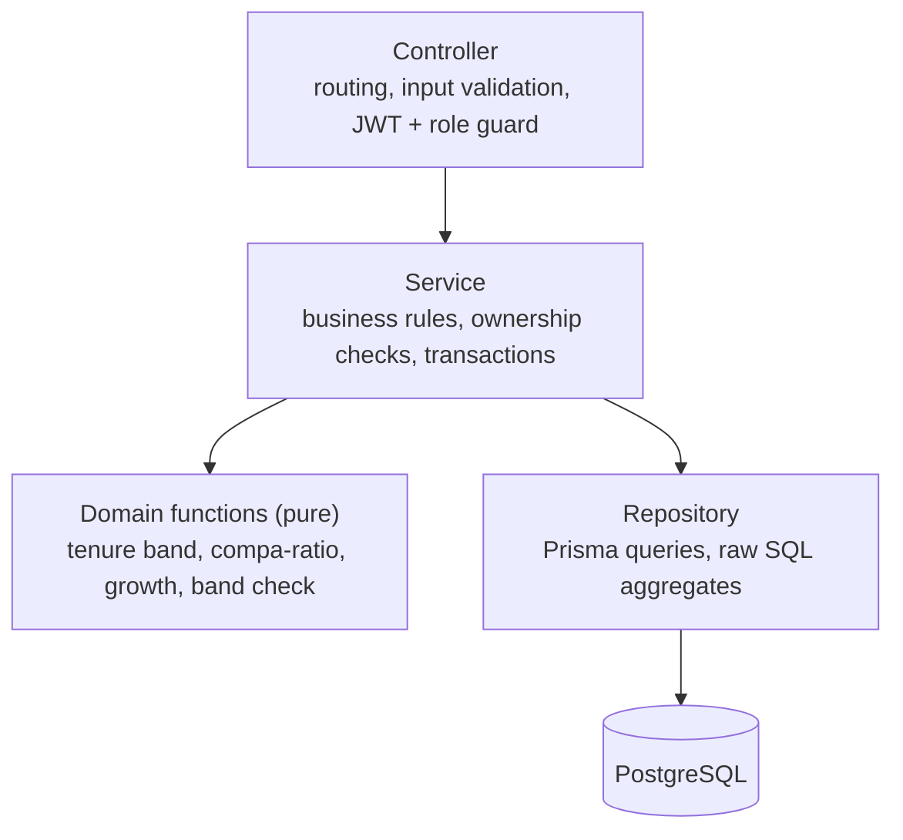
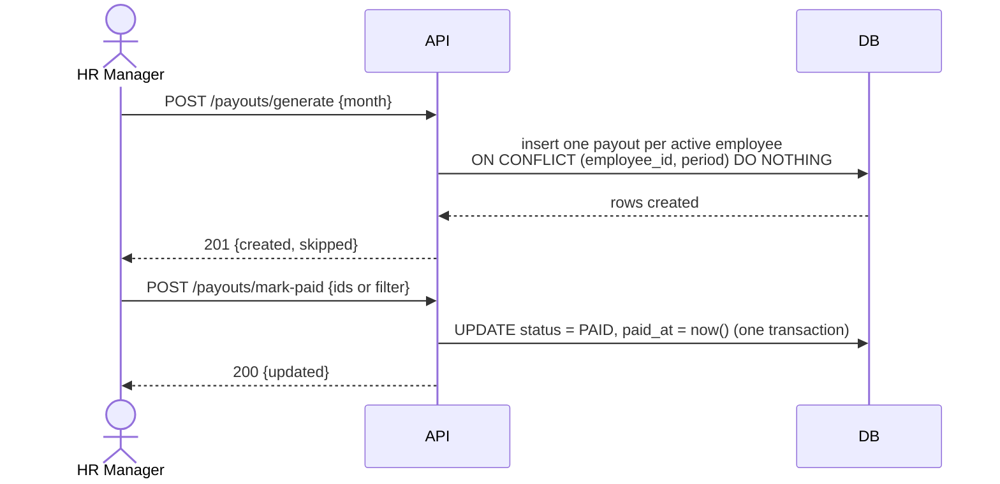
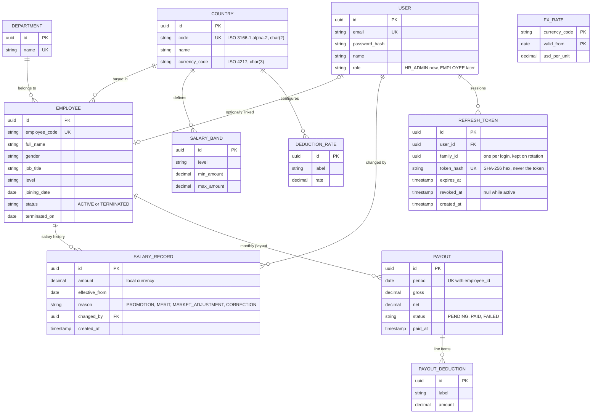
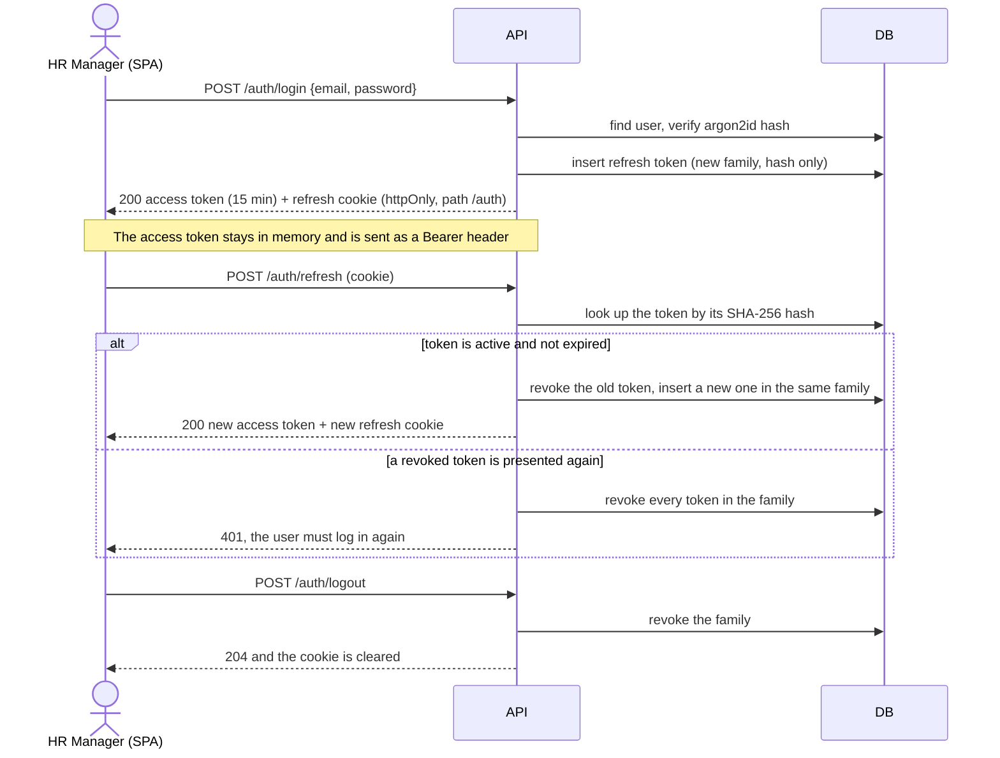

# Architecture

**Status:** proposed design, written before the implementation. Diagrams are updated when the code diverges. The final data model lives in `backend/prisma/schema.prisma`.

## 1. System overview and deployment

```mermaid
flowchart LR
  HR([HR Manager<br/>browser]) -->|HTTPS| UI[React SPA<br/>Vercel]
  UI -->|"REST + JWT"| API[NestJS API<br/>Render]
  API -->|"Prisma + pg adapter<br/>pooled URL"| DB[(Neon Postgres 16)]
  MIG[Prisma migrations] -->|direct URL| DB
  SEED[Seed script<br/>10,000 employees] -->|direct URL| DB
  CI[GitHub Actions<br/>lint, test, build] -.->|on every push| API
```

- The browser only talks to the API. The database is never exposed to the client and credentials live only in server-side environment variables.
- The running API uses Neon's pooled endpoint. Migrations and the seed script use the direct endpoint, because they hold long-lived sessions and advisory locks.

## 2. Backend layering

Planned Nest modules: `auth`, `employees`, `salaries` (history and bands), `payouts`, `insights`, `export`. Each follows the same controller → service → repository shape.

Why this shape: domain rules are pure functions, so most unit tests need no database and run in milliseconds. Authorisation lives in services, so adding an `EMPLOYEE` role later means new guards and screens, not a redesign (requirements §3).

## 3. Monthly payout flow (F6)

Generation is idempotent: a unique constraint on `(employee_id, period)` means re-running it for the same month cannot create duplicates.

## 4. Data model (proposed)

**Implemented so far:** `users`, `countries`, `departments`, `refresh_tokens`. Tables are added one at a time, each reviewed and migrated separately; everything else below is still proposed.

Notes:

- `SALARY_RECORD` is append-only. The current salary is the latest record with `effective_from <= today`. This is what makes every change auditable and growth computable (F3, F9).
- All money columns are `NUMERIC` (Prisma `Decimal`), never floating point.
- `FX_RATE` is a dated table, not tied to a country by foreign key: a country's `currency_code` selects the rate row in force on a given date, so USD comparisons are reproducible.
- Terminated employees are kept (`status`), never deleted, so history and payouts stay intact.

## 5. Authentication and refresh tokens

- **Access token:** a JWT valid for 15 minutes, carrying the user id and role. It is checked without a database call.
- **Refresh token:** a random 256-bit value, not a JWT. Only its SHA-256 hash is stored, and it lasts 7 days. SHA-256 is enough here because the value is random and long, unlike a password.
- **Secure by default:** a global JWT guard protects every route. Only login, refresh, `/health*` and `/docs*` are marked `@Public()`. `@Roles('HR_ADMIN')` handles role checks.

| Threat | Mitigation |
|---|---|
| Database leaked | Only token hashes are stored. Passwords are argon2id hashes. |
| XSS steals a token | The access token lives in memory and the refresh token is an httpOnly cookie, so scripts cannot read it. |
| Refresh token stolen and replayed | Rotation makes each token single-use. A replay revokes the whole family. |
| CSRF on refresh | SameSite cookie, path `/auth`, POST only. |
| Password guessing | Rate limit on login, one generic error message, and a dummy hash when the email is unknown so timing does not reveal accounts. |

Trade-offs, accepted on purpose:

- **An access token cannot be revoked early.** A role change or deactivation takes effect within 15 minutes. A denylist would add a database read to every request.
- **Sliding 7-day expiry, no absolute session cap in v1.** Simpler; revisit if the requirements need a maximum session length.
- **Parallel refreshes can look like reuse.** Two tabs refreshing with the same token would trip reuse detection. The UI will refresh through a single in-flight request instead of adding a grace window to the API.
- **Cross-site cookies.** Vercel and Render are different sites, and some browsers block cross-site cookies. The plan is for Vercel to proxy `/api/*` to Render so the browser sees one origin. To be verified at deploy time (M9).
