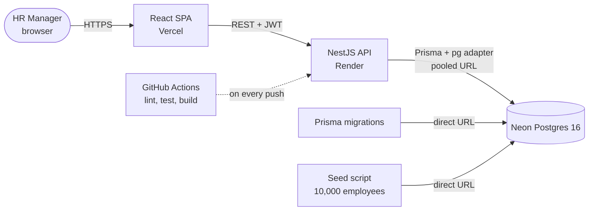
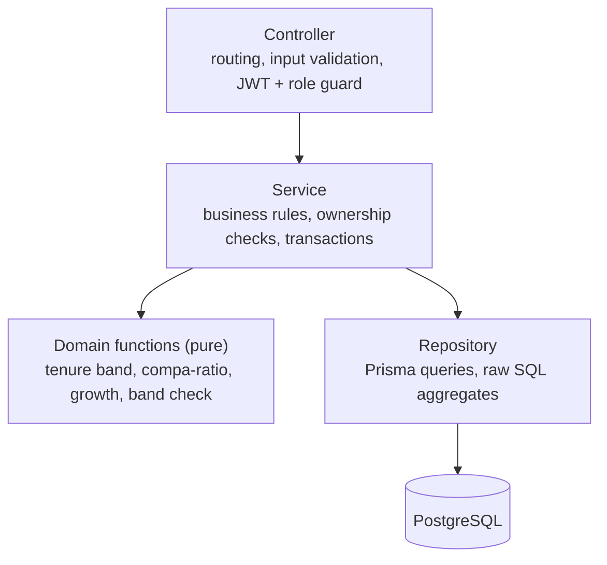
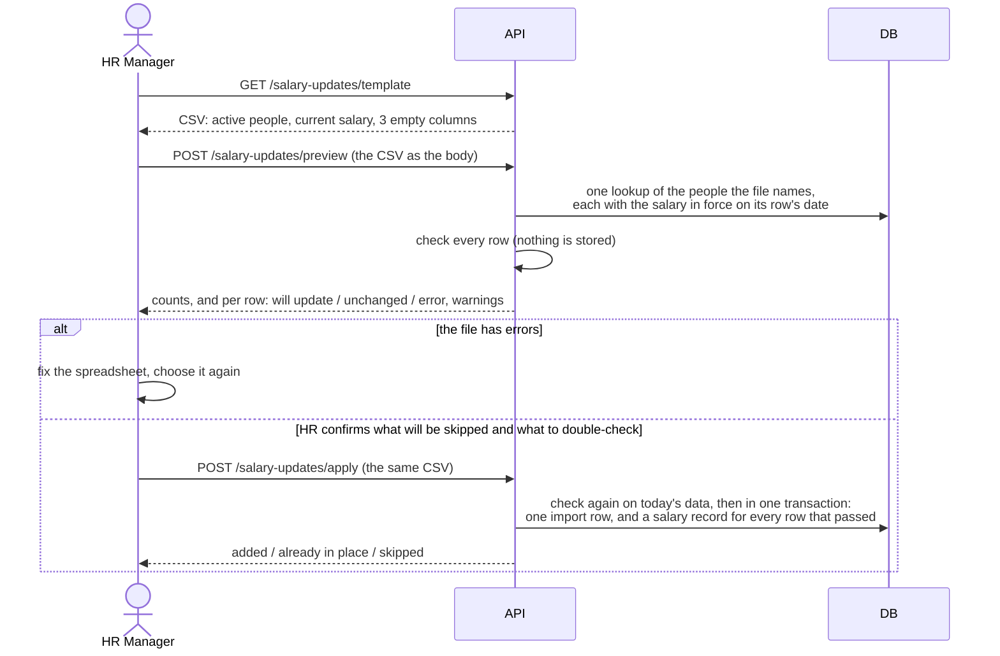
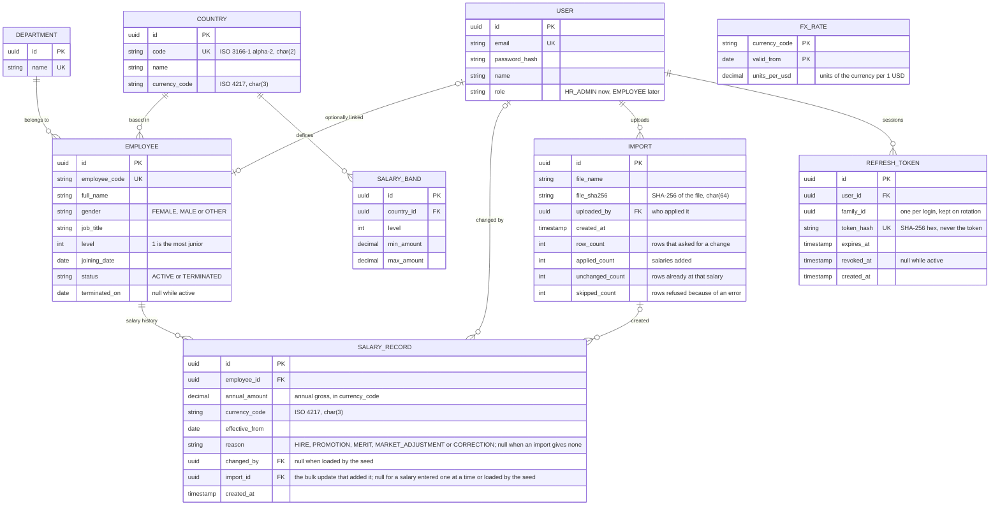
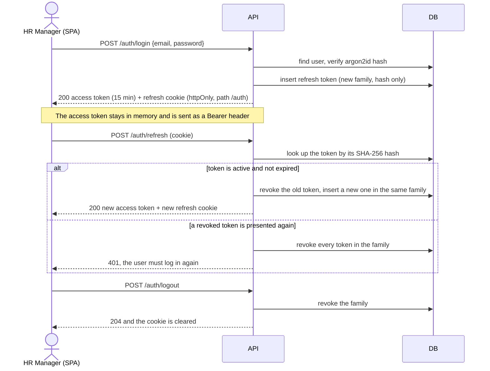

# Architecture

**Status:** proposed design, written before the implementation. Diagrams are updated when the code diverges. The final data model lives in `backend/prisma/schema.prisma`.

## 1. System overview and deployment

- The browser only talks to the API. The database is never exposed to the client and credentials live only in server-side environment variables.
- The running API uses Neon's pooled endpoint. Migrations and the seed script use the direct endpoint, because they hold long-lived sessions and advisory locks.

## 2. Backend layering

Nest modules: `auth`, `employees` (the directory, the profile, salary changes and the export), `salary-updates` (the bulk update), `insights` (pay figures by country, department and level); still to come: salary bands. Each follows the same controller → service → repository shape.

Why this shape: domain rules are pure functions, so most unit tests need no database and run in milliseconds. Authorisation lives in services, so adding an `EMPLOYEE` role later means new guards and screens, not a redesign (requirements §3). Why repositories exist, what they cost, and the rules that keep them thin are in [tech-stack.md](tech-stack.md) decision 12.

## 3. Bulk salary update flow (F6)

The HR Manager changes many salaries from a spreadsheet: download a template, fill in the changes, upload the CSV, see every row checked, then apply (see [requirements.md](requirements.md) §2 and §3, and [tech-stack.md](tech-stack.md) decision 22). Both halves are built.

- **Stateless preview.** Nothing is stored between the preview and applying: the browser sends the file again. The preview and applying run the same check (one pure function), so there is no draft to expire or clean up.
- **Applying checks again, on purpose.** It acts on the data as it is when applying, not as it was at the preview, so a salary changed in between is never overwritten by a stale preview. The result says what was actually added.
- **Judged on the row's own date.** A row is "already in place" when the salary in force on its effective date equals the new amount. Judging against today's salary would add a raise dated next month a second time on a repeat; this was found in review and has a test.
- **Repeatable.** Applying the same file again adds nothing, including for future-dated rows; measured on the real data, 9,426 rows applied and applied again with nothing added.
- **Rows with errors are skipped, not applied,** after the person confirms; valid rows are applied. A salary is only ever added: nothing is edited or deleted, and a mistake is put right with a later `CORRECTION`.
- **Traceable.** Every salary an update adds points back to its import (file name, a SHA-256 of the file, who applied it, when, and the counts), so any salary can be traced to the file it came from. An import is only recorded when at least one salary is added.
- **All or nothing.** Applying is one transaction, so a failure part-way leaves no half-applied update.
- **People are not touched.** The update adds salaries to existing employees; it does not create, edit or end anyone's employment (requirements §4).

## 4. Data model (proposed)

**Implemented:** `users`, `countries`, `departments`, `refresh_tokens`, `employees`, `salary_records`, `salary_bands`, `fx_rates` and `imports`: every table in this model exists. Tables were added one at a time, each reviewed and migrated separately.

Notes:

- `SALARY_RECORD` is append-only. The current salary is the latest record with `effective_from <= today`, with ties going to the newest `created_at`, so a correction can share the date of the record it fixes. This is what makes every change auditable and growth computable (F3, F9). An import appends a record only when the amount differs from the current one (F6).
- **`salary_records` is built**, without `import_id`: that column is added, nullable, when the `imports` table is designed (M6), which is an additive change with no data migration. The other choices: `annual_amount` is an annual gross figure (monthly is that divided by 12), `numeric(14,2)`; `currency_code` is stored on every record, so a person who later moves country does not silently change what their history means; `reason` is optional because a spreadsheet rarely says why a salary changed (the API requires one for a change made in the app); `changed_by` is null only for records the seed loaded, and a user who changed a salary cannot be deleted, so the audit trail survives; and nothing is unique on `(employee_id, effective_from)`, so a correction can share a date.
- **Append-only is a rule of the code, not of the database.** The repository for this table will offer inserts and reads, never update or delete; enforcing it in Postgres would need a trigger, which is hand-written SQL, and can be added if that proves not to be enough. `annual_amount > 0` is validated by the API for the same reason. No secondary indexes yet; the likely first one is `(employee_id, effective_from DESC)`, added after salary history is seeded and the query plans show a need.
- `IMPORT` is what makes uploads traceable: each import records who uploaded it, its outcome counts and whether it was applied, and the salary records it created point back to it. Its exact columns are settled when the table is designed.
- All money columns are `NUMERIC` (Prisma `Decimal`), never floating point.
- `FX_RATE` is a dated table, not tied to a country by foreign key: a country's `currency_code` selects the rate row in force on a given date, so USD comparisons are reproducible. **It is built.** It stores `units_per_usd` (how many units of the currency one dollar buys, so a USD amount is `amount / units_per_usd`) rather than `usd_per_unit`, because the seeded pay is built from rates such as 83 rupees or 0.92 euros per dollar, which a decimal stores exactly, whereas 1/83 cannot be. One row per currency including USD (1), `valid_from` 2010-01-01 so it covers all of the history; the rates are illustrative, not market data.
- **`salary_bands` is built:** one row per country and level (15 x 7 = 105), unique on `(country_id, level)`, in the country's currency and the unit of `salary_records.annual_amount`. Min and max are the pay model's department-neutral midpoint minus and plus 15%. There is no per-department band (that would be 1,050 rows), so a department that pays below the country norm shows up as under the band: on the seeded data 15.1% of people are outside their band overall, with 31% of Customer Support under it and 13% of Engineering over it. That is a visible finding, not a bug, and the seed (not the schema) decides it. `min_amount < max_amount` is validated by the API.
- Terminated employees are kept (`status`), never deleted, so their salary history stays intact. The foreign keys to `countries` and `departments` are `ON DELETE RESTRICT`, so a country or department with employees cannot be deleted either.
- `employees` has no secondary indexes yet, on purpose. They are added after the 10,000-employee seed, only where `EXPLAIN` shows a need, and the before and after are recorded in [performance.md](performance.md). Only the unique `employee_code` is indexed, because uniqueness needs it.
- `status` and `terminated_on` belong together (`TERMINATED` has a date, `ACTIVE` does not). The database does not enforce it, because Prisma cannot express that check without hand-written SQL; the service's single terminate operation sets both, and a `CHECK` can be added if that proves not to be enough.
- `level` is an integer so it sorts correctly (text would put 10 before 2). Its range is validated by the API, not the database. `job_title` is free text for now.
- Gender and level feed the pay insights (the gender pay gap by level, median pay by level), so they are plain columns on the employee rather than separate tables. Job title is a directory filter (F2), not an insight dimension.

## 5. Authentication and refresh tokens

- **Access token:** a JWT valid for 15 minutes, carrying the user id and role. It is checked without a database call.
- **Refresh token:** a random 256-bit value, not a JWT. Only its SHA-256 hash is stored, and it lasts 7 days. SHA-256 is enough here because the value is random and long, unlike a password.
- **Rotation is one atomic step.** Retiring the old token and storing the new one happen in a single transaction (`RefreshTokensRepository.rotate`). The old token is retired with a conditional update (`WHERE revoked_at IS NULL`), so when two requests present the same token the database lets exactly one through. The loser is treated as a replay. If the transaction cannot start, nothing was consumed and the user keeps a valid token.
- **A refused refresh clears the cookie.** Every 401 from `/auth/refresh` also expires the cookie, so the browser stops sending a token that can no longer work. The error message is the same for a missing, unknown, expired or replayed token.
- **Secure by default:** a global `JwtAuthGuard` protects every route, so a route someone forgets to think about needs a token. Only login, refresh, logout and `/health*` are marked `@Public()` (logout because it reads the refresh cookie and must work after the access token has expired). The Swagger pages at `/docs*` are served outside Nest's routing, so the guard never sees them.
- **How a token is checked:** from its signature alone, with no database call. The algorithm is pinned to HS256, so `none` or any other algorithm is refused; `exp`, a user-id `sub` and a known `role` must all be present; and every failure gets the same 401 message. A second global guard, `RolesGuard`, runs after it: a route with `@Roles('HR_ADMIN')` needs one of the listed roles (403 otherwise), and a route with no `@Roles` is open to any signed-in user. The order matters (a request with no token must be a 401, not a 403), and a test pins it.
- **Role in the token is up to 15 minutes old.** That is the same trade-off as for revocation. `GET /auth/me` reads the user from the database, so it always shows the current role.

| Threat | Mitigation |
|---|---|
| Database leaked | Only token hashes are stored. Passwords are argon2id hashes. |
| XSS steals a token | The access token lives in memory and the refresh token is an httpOnly cookie, so scripts cannot read it. |
| Refresh token stolen and replayed | Rotation makes each token single-use. A replay revokes the whole family. |
| CSRF on refresh | SameSite cookie, path `/auth`, POST only. |
| Password guessing | Rate limit on login per client address (5 per minute by default), one generic error message, a dummy hash when the email is unknown so timing does not reveal accounts, and argon2id so each guess is expensive. |

Trade-offs, accepted on purpose:

- **An access token cannot be revoked early.** A role change or deactivation takes effect within 15 minutes. A denylist would add a database read to every request.
- **Sliding 7-day expiry, no absolute session cap in v1.** Simpler; revisit if the requirements need a maximum session length.
- **Parallel refreshes can look like reuse.** Two tabs refreshing with the same token would trip reuse detection. Checked against the real database with two simultaneous requests: one succeeded, the other got a 401 and revoked the family, so the winner's new token was revoked too and its next refresh will fail. The UI will therefore refresh through a single in-flight request instead of adding a grace window to the API.
- **Cross-site cookies.** Vercel and Render are different sites, and some browsers block cross-site cookies. The plan is for Vercel to proxy `/api/*` to Render so the browser sees one origin. To be verified at deploy time (M9). A proxy that adds a path prefix would also change the cookie path (`REFRESH_COOKIE_PATH` in `refresh-cookie.ts`), which is why that value lives in one place.
- **Login rate limit needs the real client address.** Behind Vercel and Render, every request arrives from a proxy. Unless the app trusts the proxy header, a per-IP limit would count all users as one and lock everyone out after a few attempts. So the limit and the `TRUST_PROXY` setting (how many proxies to trust, default 0) were built and tested together. The two ways to get it wrong fail differently: **too low** makes everyone share one limit (annoying, but safe); **too high** lets a client forge `X-Forwarded-For` and get a fresh allowance on every request (a bypass). With the default of 0 the header is ignored, so the safe direction is the default. The right value for Vercel in front of Render cannot be known until deploy, so it is **unverified**; `backend/README.md` has a three-step check using two networks. It belongs in the M9 deploy checklist.
- **Rate limit design choices.** Failed and successful attempts both count, so the limit cannot be used to test passwords. It applies to login only: refresh and logout take a random 256-bit token and cost one indexed lookup, so they are not worth limiting yet. There is **no per-account limit on purpose**: it would let anyone lock the HR manager out just by sending wrong passwords for their email. The cost is that an attacker with many addresses is not slowed down by this limit, which is what argon2id and a strong password are for. Counts are kept in memory, so they are per process and reset on restart: correct for one Render instance, and a Redis store would be needed for more. IPv6 clients are counted by /64 prefix, so rotating addresses inside one network does not help.

**Implemented so far:** `POST /auth/login` (env-validated signing secret, argon2id at the OWASP minimum cost of 19 MiB, a dummy verification for unknown emails, one error message for every failure). Emails are lower-cased by the request schema, so the database lookup is a plain exact match; the seed must store emails in lower case too. `POST /auth/refresh` is built too: it reads the cookie (`cookie-parser`), rotates the token, revokes the family on reuse, and re-reads the user so a changed role reaches the next access token. `POST /auth/logout` is built too: it revokes the family of the cookie's token and clears the cookie. It reads only the cookie, never the access token, so it works after the access token has expired, and it always returns 204, even for a missing or unknown token. It ends one login session only; the user's other devices stay logged in, and the access token stays valid for the rest of its 15 minutes (the accepted trade-off above). The global guards are built too (above), with `GET /auth/me` as the first protected route and Swagger bearer auth (the "Authorize" button). The login rate limit is built too (above). The auth milestone is complete. There is deliberately no admin seed: the author creates the HR manager by hand (see `backend/README.md`), and the 10,000-employee seed is separate work in M3.
